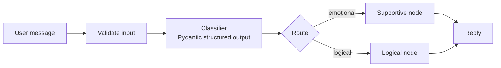

# AI Agent Router

A small LangGraph workflow that classifies a user message with structured output, then sends it to
one of two prompt-specialized response nodes.

**Status:** educational prototype. It runs as a Python module and CLI. It is single-turn, with no
memory between messages, no external tools, and no deployed backend. It is a routed LLM workflow rather
than an autonomous agent.

## How it works



Each message makes two model calls: one to classify and one to respond. The response node only sees the
current message.

The supportive node is a listener and states that it is not a therapist. It should not be used as
mental health care.

## Setup

Requires Python 3.11 or newer.

```bash
git clone https://github.com/tahamohmadf19-dev/AI-Agent-Router.git
cd AI-Agent-Router
python -m venv .venv
source .venv/bin/activate      # Windows: .venv\Scripts\activate
pip install -e ".[dev]"
```

To call a real model, create a `.env` file (this repository ignores it):

```
ANTHROPIC_API_KEY=your-key
# Optional. Any model id supported by LangChain's init_chat_model.
ROUTER_MODEL=anthropic:claude-sonnet-4-5
```

## Usage

```bash
agent-router "What is the capital of France?"
```

```python
from main import run_once

result = run_once("I feel stressed about my exams.")
print(result["route"], result["reply"])
```

| Exit code | Meaning |
|---:|---|
| 0 | Replied |
| 1 | The model provider failed |
| 2 | Invalid input (empty, or over 4,000 characters) |

## Tests

```bash
python -m pytest
```

The tests use a fake model, so they need no API key or network. They cover both routes, input validation,
provider failures, and the single-turn behavior. **They do not measure how well a real model classifies
messages.** No routing accuracy has been evaluated.

## Limitations

- Mixed messages go to one route only.
- There is no conversation memory, retrieval, or tool use.
- Two model calls per message add cost and latency compared with one.

## License

MIT. See [LICENSE](LICENSE).
